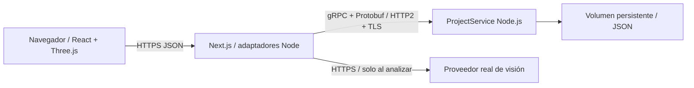

# SpaceAI 3D

Actualización: Claude ya está integrado y configurado localmente. Consulta [CLAUDE_DESPLIEGUE.md](CLAUDE_DESPLIEGUE.md) para variables, prueba real y despliegue. Las secciones anteriores sobre ausencia de credenciales describen el estado previo.

Si el dashboard publicado no crea proyectos, consulta [DESPLIEGUE_URGENTE.md](DESPLIEGUE_URGENTE.md): el despliegue inicial en Vercel carecía de APP_PASSWORD y el backend gRPC aún no estaba desplegado. Las credenciales locales generadas para la aplicación están en archivos `.env.*` excluidos de Git; no son claves de un proveedor de IA.

Organizador de espacios interiores con editor 3D, análisis opcional de fotografías mediante IA real y almacenamiento mediante **gRPC sobre HTTP/2**.

**Nuevo: generación de mallas GLB con texturas desde fotografías mediante Meshy**, incorporación al organizador, descarga y persistencia binaria en el backend gRPC. Consulta [GENERACION_3D.md](GENERACION_3D.md) para activar el proveedor y conocer la validación pendiente con una cuenta real.

## Caso de estudio y objetivos

Una persona quiere reorganizar su dormitorio o sala antes de mover físicamente sus muebles. Crea un proyecto, define medidas aproximadas, carga una referencia fotográfica y organiza una escena editable. Si configura un proveedor de visión, obtiene una primera distribución estimada. El objetivo académico es combinar una aplicación web interactiva con un servicio gRPC real y preparar ambos para la nube.

## Tecnologías y arquitectura

- Next.js App Router, React, TypeScript y Tailwind CSS 4.
- Three.js, React Three Fiber y Drei para geometrías, luces, sombras y cámara orbital.
- Node.js, `@grpc/grpc-js`, `@grpc/proto-loader` y Protocol Buffers.
- Zod valida escenas al recibir IA, guardar y recuperar.
- API de visión compatible con Chat Completions, configurable del lado servidor.



Las rutas HTTP son adaptadores para el navegador: **cada operación de proyectos llama a un RPC real**. No hay persistencia alternativa en localStorage ni simulación de gRPC. El navegador no puede usar directamente el cliente gRPC de Node.

```text
app/                 Páginas, estilos y adaptadores HTTP
components/          Dashboard, editor y visor 3D
lib/scene.ts         Esquema compartido y catálogo
lib/grpc.ts          Cliente gRPC del servidor y carga del contrato
backend/server.ts    Servicio gRPC y persistencia atómica en archivos
proto/space.proto    Contrato Protocol Buffers
tests/               Integración real contra otro proceso gRPC
Dockerfile.grpc      Contenedor del backend
fly.toml             HTTP/2, TLS en proxy y volumen
```

## Funcionalidades

- Dashboard responsive, crear, listar, abrir y eliminar proyectos.
- Habitación con dimensiones editables, piso y dos paredes abiertas para ver el interior.
- Catálogo: cama, mesa, silla, sofá, armario y planta.
- Selección en escena o lista, movimiento por coordenadas X/Z, giro, dimensiones, color y eliminación.
- Cámara orbital con zoom y desplazamiento usando OrbitControls.
- Guardar escena y recuperarla desde el servidor gRPC, incluso tras reiniciar el proceso.
- Carga y vista previa local de JPEG, PNG o WebP hasta 3 MB. El límite contempla la expansión de base64 dentro del límite de 4.5 MB de Vercel.
- Análisis real opcional, errores explícitos y modo manual cuando no hay clave.
- Flujo de revisión: **cargar → analizar con IA → corregir medidas y seleccionar muebles → generar → editar → guardar**. El análisis nunca reemplaza la escena; generar siempre solicita confirmación.
- Aviso de cambios sin guardar al cambiar de proyecto o cerrar la página.

## Limitaciones y alcance de IA

**El análisis de distribución no es fotogrametría ni una reconstrucción geométrica exacta desde una imagen.** En ese flujo, la IA estima tipo de habitación, medidas y muebles visibles; el visor los representa con geometrías paramétricas. El flujo adicional **Fotografía → modelo 3D con IA** sí integra generación de mallas GLB con texturas mediante Meshy. Ambos requieren revisar y corregir medidas. No hay detecciones ni mallas inventadas cuando falta configuración.

La fotografía solo vive en la sesión del navegador y no se guarda con la escena. Al pulsar analizar se envía al proveedor configurado, que puede cobrar según la cuenta del usuario. No se realizan llamadas de IA al cargar la imagen. Por defecto se usa OpenAI Chat Completions con imágenes y **Structured Outputs (`json_schema`, estricto)**. Para proveedores compatibles que solo admitan modo JSON, configurar `AI_RESPONSE_FORMAT=json_object`; el esquema también se envía en el prompt y siempre se valida con Zod. No hay reintentos automáticos que generen llamadas adicionales.

## Análisis de imágenes y generación

1. En el estudio, selecciona JPG/JPEG, PNG o WebP de hasta 3 MB. Se comprueban MIME, firma binaria, tamaño y decodificación de la vista previa. Se rechazan imágenes que superen 40 megapíxeles en el navegador. El servidor vuelve a verificar tamaño, base64 y firma; el proveedor valida el contenido visual.
2. Pulsa **Analizar con IA**. `app/api/analyze/route.ts` autentica la petición y llama a `lib/vision.ts` exclusivamente en Node.js. La foto no se registra en logs ni se persiste. La llamada tiene límite de 45 segundos; la ruta dispone de 60 segundos. También se limitan los cuerpos en streaming, aunque no traigan Content-Length.
3. La respuesta contiene `isInterior`, `roomType`, `summary`, dimensiones estimadas, `floorVisible`, `visibleWallCount`, objetos y advertencias. Cada objeto contiene categoría, nombre, tamaño, color, orientación, confianza de identificación y coordenadas relativas `u/v`. Se rechazan JSON inválido, datos faltantes, valores fuera de rango, rechazos del modelo y respuestas truncadas; los errores no alteran la escena actual.
4. Revisa el resumen, suelo y paredes visibles, objetos compatibles y objetos sin modelo. Corrige las dimensiones de habitación y muebles; puedes cambiar posiciones relativas, rotaciones y desmarcar objetos. Las categorías admitidas siguen siendo cama, mesa, silla, sofá, armario y planta. `unsupported` se muestra como **sin modelo** y se excluye; no se inventa una reconstrucción.
5. Pulsa **Generar espacio 3D** y confirma el reemplazo. `lib/analysis.ts` transforma el análisis al mismo esquema `Scene` que ya usa el editor. El suelo y las dos paredes abiertas del visor son geometrías de referencia rectangular, no paredes reconstruidas de la fotografía. Las dimensiones siguen siendo editables.
6. Edita con las herramientas existentes y pulsa **Guardar proyecto**. Se conserva el flujo Next.js → `SaveScene` gRPC → disco; recuperar usa `GetProject` y `GetScene`. La fotografía y el informe de análisis no se guardan: se guarda la escena editable resultante.

### Cómo se estiman las coordenadas

El modelo estima posiciones sobre un plano de suelo: `u=0` izquierda, `u=1` derecha; `v=0` fondo y `v=1` frente. **No son píxeles transformados por una calibración ni profundidad medida**: la perspectiva y las oclusiones solo aportan indicios. El convertidor centra el origen de Three.js en el suelo y usa:

```text
x = (2u - 1) × max(0, anchoHabitación/2 - semiextensiónRotadaX)
z = (2v - 1) × max(0, fondoHabitación/2 - semiextensiónRotadaZ)
```

Las semiextensiones se calculan con ancho, fondo y seno/coseno de la rotación para respetar los bordes cuando el objeto cabe. Los muebles demasiado grandes se centran en los ejes sin espacio y se advierte que deben corregirse; no se cambia su tamaño silenciosamente. No se detectan colisiones ni se garantiza una distribución físicamente exacta.

### Configurar IA real

Copia `.env.example` a `.env.local` **solo si todavía no existe**, completa tu propia clave en el archivo local y reinicia Next.js. No pegues claves en el código ni en capturas públicas.

```dotenv
AI_API_KEY=tu_clave_privada
AI_BASE_URL=https://api.openai.com/v1
AI_MODEL=gpt-4o-mini
AI_RESPONSE_FORMAT=json_schema
```

`AI_MODEL` debe estar disponible en tu cuenta y admitir imágenes, Chat Completions y el formato elegido. Un proveedor compatible se configura cambiando `AI_BASE_URL` (incluyendo `/v1` cuando corresponda), modelo y formato; HTTPS es obligatorio salvo en localhost para un proveedor local. Las claves permanecen en el servidor y no usan `NEXT_PUBLIC_`. Sin clave, el botón se deshabilita y el editor manual sigue disponible. La integración con el proveedor real **no se considera validada sin una prueba con credenciales y una fotografía real**.

El MVP es un estudio compartido protegido por contraseña, sin cuentas individuales, colaboración simultánea, historial, colisiones ni restricción de muebles a las paredes. El movimiento es mediante controles numéricos, no arrastre del mueble. Las escrituras usan archivos temporales y renombrado; la última escritura concurrente prevalece. Usar **una sola instancia** con volumen persistente. Hacer copias del volumen. Para múltiples usuarios o réplicas se necesita una base de datos y autorización por usuario.

## Instalación y ejecución local

Requiere Node.js 24 LTS y npm. En PowerShell se usa `npm.cmd` para evitar bloqueos de scripts `npm.ps1`.

```powershell
npm.cmd ci
Copy-Item .env.example .env.local
npm.cmd run dev:all
```

Abrir [http://localhost:3000](http://localhost:3000). En desarrollo la contraseña es opcional. Si la estableces, introdúcela en “Acceso al estudio” y pulsa “Actualizar proyectos”. No se conserva al recargar la página.

Por separado, en dos terminales:

```powershell
npm.cmd run grpc
```

```powershell
npm.cmd run dev
```

En modo producción local, configurar `APP_PASSWORD` en `.env.local`, ejecutar `npm.cmd run build` y `npm.cmd start`, manteniendo el backend en otra terminal. El backend carga `.env.local` mediante el script `grpc`; Next.js la carga automáticamente.

## Variables de entorno

| Variable                           | Dónde   | Descripción                                                                                      |
| ---------------------------------- | ------- | ------------------------------------------------------------------------------------------------ |
| `GRPC_ADDRESS`                     | Next    | Host:puerto, local `localhost:50051`; cloud `tu-app.fly.dev:443` (sin https://)                  |
| `GRPC_TLS`                         | Next    | `false` local; **`true` en nube**, valida certificado del servidor                               |
| `GRPC_TOKEN`                       | Ambos   | Secreto compartido para metadata Authorization; obligatorio configurar en nube                   |
| `GRPC_BIND`                        | Backend | Local `127.0.0.1:50051`; contenedor `0.0.0.0:50051`                                              |
| `DATA_DIR`                         | Backend | `./data` local; `/data` en volumen cloud                                                         |
| `GRPC_CERT_PATH` / `GRPC_KEY_PATH` | Backend | Archivos TLS si se termina TLS directamente; vacíos con proxy TLS de Fly                         |
| `APP_PASSWORD`                     | Next    | Contraseña del estudio. Obligatoria en producción; sin ella los adaptadores rechazan operaciones |
| `AI_API_KEY`                       | Next    | Opcional, habilita análisis real; nunca usar prefijo NEXT_PUBLIC                                 |
| `AI_BASE_URL`                      | Next    | Por defecto `https://api.openai.com/v1`                                                          |
| `AI_MODEL`                         | Next    | Por defecto `gpt-4o-mini`; sustituir por modelo de visión disponible en tu cuenta                |
| `AI_RESPONSE_FORMAT`               | Next    | `json_schema` por defecto; `json_object` para proveedores compatibles sin salida estricta        |

No subir `.env.local` ni certificados al repositorio. `.env.example` solo contiene valores de ejemplo. El backend gRPC no necesita clave de IA.

## gRPC y comprobación

`proto/space.proto` define `spaceai.ProjectService`:

| RPC           | Función                            |
| ------------- | ---------------------------------- |
| CreateProject | Crear metadatos y habitación vacía |
| GetProjects   | Listar proyectos                   |
| GetProject    | Consultar metadatos                |
| SaveScene     | Validar y persistir JSON de escena |
| GetScene      | Recuperar escena                   |
| DeleteProject | Borrar proyecto y escena           |

Los mensajes usan Protocol Buffers; la escena viaja en `sceneJson` validado por Zod. El cliente tiene deadline de 8 s; errores gRPC se presentan en el frontend. El servidor verifica el token cuando está configurado y limita mensajes a 1 MB.

```powershell
npm.cmd run typecheck
npm.cmd test
npm.cmd run build
```

La prueba inicia un servidor separado en `127.0.0.1:50059` con directorio temporal y token. Ejecuta los seis RPC, comprueba rechazo de token y escena inválidos, reinicia el backend para demostrar persistencia y comprueba eliminación. No necesita IA ni el servidor de desarrollo.

`tests/analysis.test.ts` convierte datos marcados como **PRUEBA, no IA real**, verifica las seis categorías, correcciones, posiciones y exclusión de objetos sin modelo. La prueba gRPC guarda una de estas escenas convertidas y la recupera después del reinicio. `tests/ai.test.ts` sustituye HTTP solo dentro de las pruebas para comprobar el contrato, respuestas inválidas/incompletas, autenticación, cuota, timeout, límites y ausencia de credenciales; no realiza llamadas pagadas. No hay un script lint ni configuración ESLint en este proyecto; se ejecutan TypeScript, pruebas y build.

`tests/helpers/vision-provider.mjs` es un proveedor HTTP **exclusivamente de pruebas**, deshabilitado salvo que se establezca `SPACEAI_FIXTURE_TEST=1`. Responde con `tests/fixtures/interior.json`, cuyo resumen y objetos dicen PRUEBA. Nunca configurar este proveedor como servicio de IA real ni desplegarlo. Se utiliza únicamente para verificar visualmente la revisión y generación sin credenciales.

Para comprobar el frontend compilado contra el backend activo, inicia `npm.cmd start -- --port 3101` después del build (con `APP_PASSWORD` configurada). En otra terminal:

```powershell
$env:SMOKE_URL="http://localhost:3101"
$env:SMOKE_PASSWORD="LA_CONTRASENA_QUE_CONFIGURASTE"
npm.cmd run test:smoke
```

Esta prueba crea y elimina un proyecto temporal mediante los adaptadores reales. No llama al proveedor de IA.

También puedes instalar `grpcurl` por tu cuenta y, con el backend iniciado, ejecutar:

```powershell
grpcurl -plaintext -import-path proto -proto space.proto -d '{"name":"Demostración"}' localhost:50051 spaceai.ProjectService/CreateProject
grpcurl -plaintext -import-path proto -proto space.proto -d '{}' localhost:50051 spaceai.ProjectService/GetProjects
```

En nube elimina `-plaintext`, usa `tu-app.fly.dev:443` y agrega `-H "authorization: Bearer TU_TOKEN"`. No se requiere reflexión porque se aporta el `.proto`. No pegues el token real en evidencia pública.

Prueba manual de entrega: crear proyecto → añadir sofá → cambiar X y rotación → guardar → volver al dashboard y abrir → comprobar valores → reiniciar backend y recuperar → cargar foto → verificar modo manual sin clave. Con clave autorizada, analizar foto y comprobar resultado antes de guardar.

## Despliegue del backend: Fly.io

**Estos son pasos para ejecutar personalmente. No se han creado recursos ni realizado despliegues. Fly.io, volúmenes y la API pueden generar costos; revisar los precios antes de ejecutar.**

1. Instala `flyctl` y autentícate con `fly auth login`.
2. Cambia `app` en `fly.toml` por un nombre global único, por ejemplo `spaceai-grpc-tu-identificador`.
3. Desde la raíz, crea la aplicación y un volumen en la misma región:

```powershell
fly apps create spaceai-grpc-tu-identificador
fly volumes create spaceai_data --region mia --size 1 --app spaceai-grpc-tu-identificador
fly secrets set GRPC_TOKEN="TU_SECRETO_LARGO_Y_ALEATORIO" --app spaceai-grpc-tu-identificador
fly deploy --ha=false --app spaceai-grpc-tu-identificador
fly scale count 1 --app spaceai-grpc-tu-identificador
fly logs --app spaceai-grpc-tu-identificador
```

El contenedor arranca Node en puerto 50051. Fly termina TLS en el puerto público 443 y `h2_backend=true` mantiene HTTP/2 hacia el proceso. No cambiarlo por un proxy HTTP/1.1. La persistencia está montada en `/data`. Mantener una única máquina asociada al volumen; no replicar este almacenamiento por archivos.

4. Verifica con `grpcurl` usando TLS y token. Debe responder `GetProjects` sin errores de transporte o autenticación. La configuración cloud no se considera verificada hasta hacer esta prueba.

## Despliegue frontend: Vercel

1. El usuario sube personalmente los archivos a su repositorio. No se ejecutaron comandos Git durante la creación.
2. En Vercel, importa ese repositorio, raíz del proyecto `./`, framework Next.js, Node 24, install `npm ci`, build `npm run build`; no configurar exportación estática.
3. Define variables del entorno Production (y Preview si lo usarás):

```dotenv
GRPC_ADDRESS=spaceai-grpc-tu-identificador.fly.dev:443
GRPC_TLS=true
GRPC_TOKEN=EL_MISMO_SECRETO_DEL_BACKEND
APP_PASSWORD=UNA_CONTRASENA_LARGA_PARA_EL_ESTUDIO
```

4. Opcionalmente agrega `AI_API_KEY`, `AI_BASE_URL`, `AI_MODEL`. No se necesita IA para entregar el editor manual.
5. Despliega desde Vercel. El `.proto` se incluye mediante `outputFileTracingIncludes` y las librerías gRPC se ejecutan en runtime **Node**, no Edge. Vercel aloja el adaptador/cliente, **no el servidor gRPC**.
6. Abre el frontend, escribe la contraseña y crea un proyecto. Añade, guarda y recupera un mueble. Si hay `UNAVAILABLE`, revisar hostname, puerto 443, TLS, estado de máquina y HTTP/2. Si hay token inválido, igualar `GRPC_TOKEN` y volver a desplegar Next.

## Documentación oficial consultada

- [gRPC Node: contrato, cliente y servidor](https://grpc.io/docs/languages/node/basics/)
- [Next.js: dependencias de servidor](https://nextjs.org/docs/app/api-reference/config/next-config-js/serverExternalPackages)
- [OpenAI: entrada de imágenes y visión](https://developers.openai.com/api/docs/guides/images-vision)
- [OpenAI: respuestas estructuradas](https://developers.openai.com/api/docs/guides/structured-outputs)
- [Fly.io: configuración HTTP/2 y volúmenes](https://fly.io/docs/reference/configuration/)
- [Vercel: límites de funciones y cuerpo de solicitudes](https://vercel.com/docs/functions/limitations)

Consulta `VALIDACION.md` para los resultados observados durante esta implementación.
