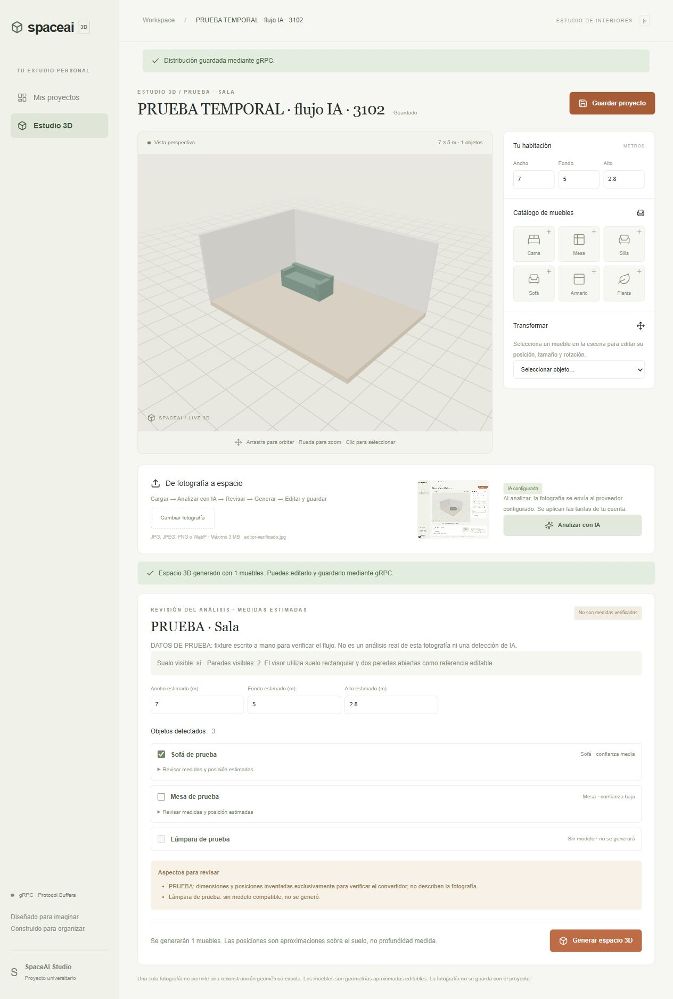
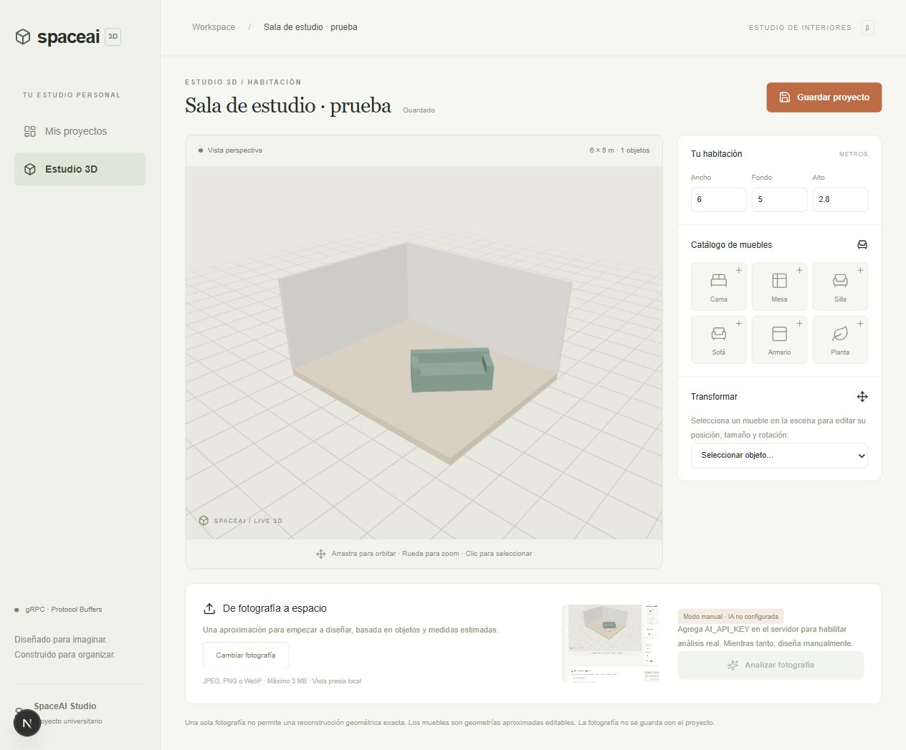

# Registro de validación — 13 de octubre de 2026

## Actualización Claude — 14 de noviembre de 2026

- Proyecto localizado en su ubicación actual: UNIVERSIDAD/proyecto mideros/taller. Se conservaron editor, persistencia, servicios gRPC y funcionalidad de Meshy/GLB existente.
- La clave autorizada por el usuario fue aceptada por GET /v1/models de Anthropic (HTTP 200); los valores no se registraron en los resultados ni en la documentación.
- Adaptador nativo POST /v1/messages con imágenes base64, herramienta de salida estricta y validación Zod. OpenAI se conserva como proveedor alternativo mediante AI_PROVIDER.
- Se verificó un análisis **real** de una fotografía pública de una sala: https://unsplash.com/photos/9M66C_w_ToM . Modelo: claude-haiku-4-5-20251001. Tiempo de la petición satisfactoria: 14495 ms.
- Resultado real: 11 objetos observados, 8 geometrías editables compatibles y 3 objetos sin modelo, informados y omitidos.
- Evidencia sin claves: docs/claude-validacion-real.json. No es un fixture de detecciones inventadas.
- Esa misma escena se guardó y recuperó por gRPC real, se reinició el servidor y se recuperó de nuevo. Se eliminó únicamente el proyecto temporal de verificación.
- npm run typecheck: código 0. npm test: **25 pruebas aprobadas, 0 fallidas**. Incluye el contrato Claude con HTTP sustituido solo en pruebas, errores, rechazo, límites, timeout y conservación de compatibilidad con OpenAI, gRPC y GLB.
- Se escaneó el código fuente, pruebas, scripts y evidencia: 0 literales de claves Anthropic. La clave configurada reside en .env.local y .env.vercel, excluidos de Git; no se modificaron las contraseñas/tokens existentes.
- La prueba real detectó fallos de salida no estricta y de objetos sin modelo con espesor menor a 0.1 m. Se corrigieron usando modo estricto, esquema anyOf compatible con Claude y dimensiones mínimas distintas solo para observaciones unsupported. Los muebles compatibles conservan los límites originales. No se omite la validación para forzar un resultado satisfactorio.
- Turbopack falló internamente creando un proceso de PostCSS en esta ubicación de Windows. Se usó Webpack y se ajustaron los scripts dev/start para certificados de sistema, sin desactivar TLS.
- Guía de variables y despliegue: CLAUDE_DESPLIEGUE.md. No se ejecutaron operaciones de Git ni despliegues. Sigue pendiente provisionar/configurar el backend cloud si solo se desplegó Vercel.
- La integración Claude produce análisis y escena paramétrica aproximada; no genera mallas GLB por sí sola. La función GLB existente sigue requiriendo la clave y créditos de Meshy.
- Por haberse compartido la clave en el chat, se recomienda revocarla y reemplazarla antes del despliegue definitivo.

Las secciones que indicaban ausencia de credenciales o de prueba real describen el estado histórico previo a esta actualización.

## Continuación verificada · 26 de octubre de 2026

- `npm.cmd test`: **20 aprobadas, 0 fallidas**, incluidos los ocho RPC (dos nuevos de modelos), persistencia tras reinicio, GLB sintético de más de 5 MB, descarga HTTP por streaming y apertura con Three.js GLTFLoader.
- `npm.cmd run build -- --webpack`: código 0; TypeScript y todas las rutas compilados. Se verificó `proto/space.proto` en el trazado de la función de modelos.
- Turbopack falla en este entorno al crear/conectar su proceso de estilos. No se cambió el script predeterminado.
- Next.js emitió una advertencia de vulnerabilidad; no se alteraron versiones sin autorización. Es necesaria revisión antes de publicar.
- Producción pública: `/api/analyze` 200 con IA desactivada, `/api/projects` 503 por configuración, `/api/models` 404. No se cambió el despliegue.
- No hay claves Meshy/visión en archivos locales ni entorno de proceso. Pruebas de contrato con HTTP simulado, **no generaciones ni detecciones reales**.
- Prueba visual aislada en `3104`, backend temporal `50072`: GLB sintético **no generado con IA** renderizado, seleccionado, movido a X=1, girado 45° y ancho ajustado a 2 m; guardado y reapertura conservaron los valores. Descarga desde el objeto recuperado completada. Evidencia `docs/glb-verificado-prueba.jpg`.
- El primer intento de vista previa coincidió con la regeneración de `.next` y falló por un manifiesto temporalmente ausente. Se resolvió arrancando después del build, sin alterar protecciones del navegador.
- Detalles de recuperación, inventario de los 28 archivos previos, limitaciones y ejecución: `../RECUPERACION.md`. Las entradas siguientes se conservan como historial anterior.

## Diagnóstico posterior de Vercel

- Consulta pública a `https://taller-beta-gray.vercel.app/api/projects`: 503, `Configura APP_PASSWORD para proteger la aplicación`.
- Consulta a `/api/analyze`: `configured:false`, `authRequired:true`.
- El usuario confirmó que únicamente desplegó el frontend en Vercel. Falta un backend gRPC público.
- Se generaron una contraseña de aplicación y un token gRPC en `.env.vercel` / `.env.grpc`, excluidos de Git y Docker, sin sobrescribir archivos ni credenciales existentes. No se configuraron en Vercel ni se generaron claves de IA.
- Se diferenciaron errores de acceso (401), configuración (503), backend inaccesible (503/504) y token gRPC incorrecto (502). Vercel sin GRPC_ADDRESS ya no intenta silenciosamente localhost.
- `npm test`: 15 pruebas aprobadas, 0 fallidas, incluida configuración de producción sin contraseña y sin backend.
- Instrucciones concretas en `DESPLIEGUE_URGENTE.md`. La nube sigue pendiente de configurar variables y desplegar backend; no se declara resuelta ni se han creado recursos de pago.

## Actualización: flujo completo de análisis y revisión

Se completó la integración existente conservando el editor, los seis métodos gRPC, el contrato `.proto`, la persistencia y las configuraciones de Fly.io/Vercel. No se instalaron dependencias nuevas.

### Verificaciones de esta actualización

- `npm run typecheck`: código 0.
- `npm test`: **14 pruebas aprobadas, 0 fallidas**, incluidos subcasos de proveedor.
- `npm run build`: código 0; rutas de análisis y proyectos dinámicas, runtime Node.js.
- No existe script lint ni configuración ESLint; no se declara una ejecución de lint.
- Se comprobó la inclusión de `proto/space.proto` en el trazado del build.
- Contrato HTTP del proveedor probado con respuestas sustituidas **solo dentro de tests**: envío de imagen y esquema estricto, compatibilidad `json_object`, salida válida, JSON inválido, respuesta incompleta/truncada, datos fuera de rango, rechazo, imagen no interior, errores 400/401/403/429/500, red y timeout.
- Validación de MIME/firma, base64, tamaño máximo, JSON de entrada y límite de cuerpos en streaming sin Content-Length. Las respuestas no exponen mensajes privados del proveedor.
- Conversión de JSON **de prueba, no detecciones reales**: categorías existentes, posiciones relativas, rotaciones, corrección de dimensiones, exclusión de muebles, advertencia de objetos demasiado grandes y omisión explícita de objetos sin modelo.
- La prueba gRPC guarda una escena convertida desde el fixture y la recupera después de reiniciar el servidor.
- `npm run test:smoke` contra producción local en puerto 3102: página, autenticación, creación/listado/guardado/recuperación y eliminación por Next.js → gRPC aprobados.
- La misma prueba contra la aplicación principal en `http://localhost:3100` también pasó. Se abrió el proyecto existente sin modificarlo y se observaron sus cuatro objetos, catálogo, transformaciones y mensaje “Modo manual · IA no configurada”.
- Prueba visual aislada en puerto 3102 con `tests/helpers/vision-provider.mjs` en localhost: **no es IA real**. El resultado muestra “DATOS DE PRUEBA” y no analiza el contenido de la imagen.
  - JPEG válido cargado y previsualizado con la nueva validación.
  - Analizar mostró el panel de revisión sin reemplazar los cero objetos de la escena actual.
  - Se corrigió el ancho a 7 m y se excluyó la mesa; la lámpara apareció como “Sin modelo”.
  - Se observó el diálogo de confirmación al generar. Se generó una habitación de 7 × 5 m con un sofá.
  - Se guardó por gRPC, se regresó al dashboard y se recuperaron dimensiones y mueble.
  - El proyecto temporal de esta prueba se eliminó por el adaptador gRPC; se conservaron los proyectos anteriores.
  - Se cerraron el proveedor fixture, la instancia de producción temporal y su pestaña; permanecieron activos la aplicación principal en 3100 y el backend gRPC en 50051.

### Estado real de IA y pendientes

**No se encontró `AI_API_KEY` ni `OPENAI_API_KEY` en el entorno, y no existía `.env.local` ni `.env`.** No se realizó una llamada a OpenAI ni a otro proveedor real. Las pruebas de contrato usan fixtures identificados como pruebas; no demuestran calidad de detección ni disponibilidad de un modelo en una cuenta real.

Para verificar con IA real, configurar `AI_API_KEY`, `AI_BASE_URL`, `AI_MODEL` y `AI_RESPONSE_FORMAT` en el servidor, reiniciar Next.js y usar una fotografía real de un interior. Verificar resultados, corregir dimensiones, generar, guardar y recuperar. La app del puerto 3100 permanece en modo manual mientras no se configure una clave. No se cambiaron credenciales existentes ni se desplegó.

Pendientes: prueba real de visión con credenciales, calidad espacial con fotografías reales, prueba cloud con TLS/HTTP2 y Docker. Las medidas y profundidades son estimadas; las paredes/suelo del editor son referencias geométricas, no una reconstrucción exacta ni mallas generadas desde píxeles.

### Archivos de esta actualización

- Nuevos: `lib/analysis.ts`, `lib/image.ts`, `lib/vision.ts`, `components/PhotoAnalysis.tsx`, `tests/analysis.test.ts`, `tests/fixtures/interior.json`, `tests/helpers/vision-provider.mjs`, evidencia visual.
- Modificados: `app/api/analyze/route.ts`, `components/Studio.tsx`, `app/globals.css`, `.env.example`, `tests/ai.test.ts`, `tests/grpc.test.ts`, `README.md`, `VALIDACION.md`.
- Sin cambios de contrato/infraestructura: `proto/space.proto`, `backend/server.ts`, `lib/grpc.ts`, `next.config.ts`, `fly.toml`, `Dockerfile.grpc`.

## Validación anterior del MVP

## Resultados observados

- Dependencias instaladas con npm; auditoría de instalación: 0 vulnerabilidades reportadas (no equivale a auditoría de seguridad completa).
- `npm run typecheck`: terminó con código 0.
- `npm test`: **3 pruebas aprobadas, 0 fallidas**.
  - Validación de dimensiones y clases de muebles.
  - Servidor gRPC real en proceso separado, seis RPC, token inválido, escena inválida, ID inválido, persistencia después de reiniciar y eliminación.
  - Sin clave de IA: respuesta 503 explícita, ninguna llamada externa y rechazo de acceso sin contraseña.
- `npm run build`: compilación de producción aprobada; rutas de proyectos y análisis ejecutadas como funciones dinámicas Node.js.
- `npm run test:smoke` contra `next start` en puerto 3101: página 200, rechazo sin contraseña, creación/listado/guardado/recuperación mediante Next.js → gRPC y eliminación del proyecto temporal aprobados.
- Verificado en los archivos de trazado de producción que `proto/space.proto` se incluye en ambos adaptadores de proyectos.
- Navegador en `http://localhost:3100`:
  - Renderizado WebGL de habitación y sofá observado visualmente.
  - Proyecto creado a través de Next.js → gRPC.
  - Sofá agregado, movido a X=1 y girado 45 grados.
  - Guardado confirmado; al volver al dashboard y abrir, se recuperaron X=1 y 45 grados.
  - Carga de un JPEG de prueba (captura propia del editor) y vista previa verificadas. No se envió a un proveedor de IA.
  - Estado “Modo manual · IA no configurada” visible y análisis deshabilitado.

## Pendiente de validación externa

- Análisis con proveedor real: no se proporcionó una clave; no se realizaron llamadas pagadas ni detecciones simuladas.
- Despliegue Vercel/Fly.io, TLS público y volumen cloud: preparados y documentados, no ejecutados.
- Imagen real de una habitación: la prueba de carga usó un JPEG de prueba; la calidad de la estimación necesita evaluación con fotografías reales y credenciales.
- No se automatizaron pruebas de todos los tamaños responsive, todos los gestos de cámara ni todos los dispositivos WebGL.
- Docker no se compiló ni se ejecutó durante la validación local.

## Incidencias del entorno resueltas

- npm fue bloqueado inicialmente por permisos de red/caché; se instaló con ejecución autorizada.
- tsx falló en el sandbox al consultar información del usuario (`uv_os_get_passwd`); las pruebas pasaron al ejecutarse fuera de ese entorno restringido.
- El puerto 3000 estaba ocupado por otra aplicación. La prueba visual de SpaceAI utilizó 3100 sin modificar esa aplicación.
- Una recarga automática del servidor interrumpió el primer selector de archivos; al reabrir el proyecto y repetir, la vista previa JPEG funcionó.

No se ejecutaron operaciones de Git, no se desplegó y no se crearon servicios de pago.

Resultado final de esta actualización: npm run build (Webpack) terminó con código 0, incluidas TypeScript, generación de páginas y trazado para despliegue. El backend local se inició en 50051 y Next.js en 3100 con la configuración Claude de .env.local.

## Parche de seguridad aplicado

Se actualizó la dependencia existente Next.js de 16.4.0 a 16.4.6 y su package-lock.json. La auditoría de npm posterior reportó 0 vulnerabilidades conocidas. Esta actualización corrige los avisos que interrumpieron el primer arranque local; no se crearon ramas ni worktrees y no se ejecutó Git.

Referencia oficial del aviso: https://github.com/advisories/GHSA-2464-fhr4-w9xw . Las 25 pruebas automatizadas se repitieron después de actualizar.

Cierre verificado: build de Next.js 16.4.6 (Webpack) con código 0; 25 pruebas aprobadas tras el parche; test:smoke contra localhost:3100 aprobado con creación, guardado, recuperación y eliminación del proyecto temporal. Frontend y backend locales permanecen activos. No se desplegó ni se ejecutó Git.

